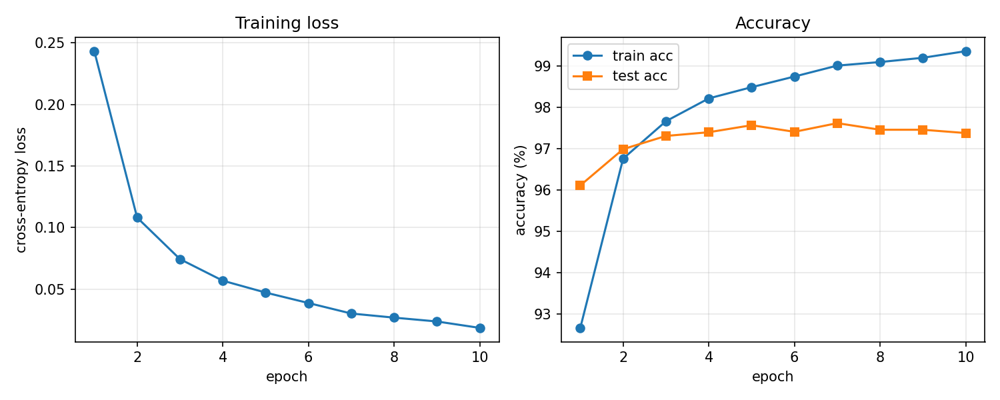

# Neural Network from Scratch (pure NumPy)

No PyTorch, no TensorFlow. Forward pass, backpropagation and optimizers are written by hand, and a two-layer MLP (784-128-10) trained with them reaches **>= 97% test accuracy on MNIST**. Every layer's `backward` is verified against **numerical gradient checks** (finite differences), so the backprop is provably correct, not just "it runs".

```
nn/
├── layers.py   # Linear, ReLU, Sigmoid, Tanh, Dropout, SoftmaxCrossEntropy (each with forward / backward)
├── optim.py    # SGD (momentum), Adam
└── model.py    # Sequential container: parameters() / train() / eval() / predict()
data.py         # downloads and parses the MNIST idx files, normalization, one-hot, minibatch iterator
train.py        # training script: per-epoch loss / accuracy, saves the training curves
tests/
├── test_gradcheck.py  # per-layer and end-to-end numerical gradient checks
└── test_optim.py      # optimizer convergence sanity tests
```

## Quick start

```bash
pip install -r requirements.txt
pytest -q            # gradient checks (~0.3 s)
python train.py      # downloads MNIST (~11 MB), trains for 10 epochs on CPU
```

Optional flags:

```bash
python train.py --optim sgd --lr 0.05 --epochs 5   # SGD with momentum instead of Adam
python train.py --hidden 256 --dropout 0.2          # wider hidden layer + dropout
```

## Results

Default config: Adam, lr = 1e-3, batch size 64, 10 epochs, He initialization, no regularization.

```
train (60000, 784), test (10000, 784)
parameters: 101,770
epoch  1/10 | loss 0.2432 | train acc 92.66% | test acc 96.11% | 2.8s
epoch  2/10 | loss 0.1081 | train acc 96.76% | test acc 96.99% | 3.5s
epoch  3/10 | loss 0.0744 | train acc 97.67% | test acc 97.31% | 4.1s
epoch  4/10 | loss 0.0569 | train acc 98.22% | test acc 97.40% | 3.6s
epoch  5/10 | loss 0.0472 | train acc 98.49% | test acc 97.57% | 3.9s
epoch  6/10 | loss 0.0387 | train acc 98.75% | test acc 97.41% | 4.6s
epoch  7/10 | loss 0.0302 | train acc 99.02% | test acc 97.62% | 4.6s
epoch  8/10 | loss 0.0269 | train acc 99.10% | test acc 97.46% | 5.4s
epoch  9/10 | loss 0.0238 | train acc 99.20% | test acc 97.46% | 3.7s
epoch 10/10 | loss 0.0185 | train acc 99.37% | test acc 97.38% | 4.2s
Final test accuracy 97.38% (best 97.62%)
```

| Metric | Value |
|---|---|
| Test accuracy (epoch 10) | **97.38%** |
| Best test accuracy (epoch 7) | **97.62%** |
| Parameters | 101,770 |
| Time per epoch (CPU, NumPy) | ~4 s |

Training accuracy keeps climbing while test accuracy plateaus around 97.5%, so the model starts to overfit slightly in later epochs. `--dropout 0.2` or `--weight-decay 1e-4` mitigates this.



## Backpropagation, derived briefly

Let $N$ be the batch size and $\delta = \partial L / \partial y$ the upstream gradient (same shape as the layer output $y$). Each layer has to answer two questions: **what is the gradient with respect to its parameters**, and **what is $\partial L / \partial x$ to pass to the layer before it**.

### Fully connected layer $y = xW + b$

$x \in \mathbb{R}^{N\times D_{in}}$, $W \in \mathbb{R}^{D_{in}\times D_{out}}$, $b \in \mathbb{R}^{D_{out}}$.

$$
\frac{\partial L}{\partial W} = x^\top \delta,\qquad
\frac{\partial L}{\partial b} = \sum_{i=1}^{N} \delta_i,\qquad
\frac{\partial L}{\partial x} = \delta\, W^\top
$$

Intuition: the gradient of $W$ is the outer product of "input" and "output gradient" summed over the batch; $b$ is added once per sample, so its gradient is $\delta$ summed over rows.

### Element-wise activations $y = \sigma(x)$

$$
\frac{\partial L}{\partial x} = \delta \odot \sigma'(x)
$$

| Activation | $\sigma(x)$ | $\sigma'(x)$ |
|---|---|---|
| ReLU | $\max(0, x)$ | $\mathbb{1}[x > 0]$ |
| Sigmoid | $s = 1/(1+e^{-x})$ | $s(1-s)$ |
| Tanh | $t = \tanh x$ | $1 - t^2$ |

The derivatives of Sigmoid and Tanh can be written in terms of the forward output, so caching the output is all that is needed.

### Softmax + cross-entropy, fused

For logits $z \in \mathbb{R}^{C}$, $p = \mathrm{softmax}(z)$ and true class $y$, the per-sample loss is $\ell = -\log p_y$.

Differentiating softmax and cross-entropy together makes most of the Jacobian cancel, leaving a very clean result:

$$
\frac{\partial \ell}{\partial z_j} = p_j - \mathbb{1}[j = y]
$$

i.e. "predicted probability minus one-hot label". For the batch mean, divide by $N$.

**Numerical stability.** Computing $e^{z}$ directly overflows for large $z$. The log-sum-exp trick fixes this:

$$
\log p_j = z_j - \max_k z_k - \log \sum_k e^{z_k - \max_k z_k}
$$

After subtracting the max every exponent is $\le 1$, so nothing overflows; $p = e^{\log p}$ is then recovered for the backward pass. `tests/test_gradcheck.py` includes a test with $z = [1000, -1000, 0]$ to confirm this.

### Chaining layers (Sequential)

For an $L$-layer network $y = f_L \circ \cdots \circ f_1 (x)$, backprop starts from $\partial L / \partial y$ and calls each layer's `backward` **in reverse order**, feeding the return value into the previous layer. `Sequential.backward` is a single `for layer in reversed(self.layers)` loop; that loop *is* the chain rule.

### Optimizers

- **SGD + momentum**: $v \leftarrow \mu v + g,\; w \leftarrow w - \eta v$
- **Adam**: exponential moving averages of the first moment $m$ and second moment $v$, bias-corrected, then $w \leftarrow w - \eta\, \hat m / (\sqrt{\hat v} + \epsilon)$

## How the gradient checks work

For any scalar function $f$, central differences give

$$
\frac{\partial f}{\partial x_i} \approx \frac{f(x + h e_i) - f(x - h e_i)}{2h},\quad h = 10^{-5}
$$

To turn a layer with vector output into a scalar, pick a fixed random matrix $R$ and set $f(x) = \sum \big(\text{layer}(x) \odot R\big)$. Then $\partial f / \partial y = R$, so `layer.backward(R)` must match the numerical gradient of $f$ with respect to $x$ (or $W$, $b$). The tests run in float64 and require a relative error below $10^{-6}$.

Beyond per-layer checks, `test_full_mlp_end_to_end_grad` chains three Linear layers, Tanh, ReLU and the cross-entropy loss and checks the whole thing, confirming that `Sequential` wires the chain rule correctly.

## Design notes

- **No autograd.** Each layer's `backward` is written by hand so the math of backprop stays visible instead of hidden inside a computation graph.
- **Softmax and cross-entropy are one class.** Implemented separately, the softmax Jacobian is a $C\times C$ matrix per sample, slow and numerically fragile; fused, the gradient is simply $p - \text{onehot}$.
- **Parameters are `Parameter(data, grad)` objects.** Optimizers only hold a list of them and never need to know which layer owns what.
- **CPU only.** A ~100k-parameter MLP in NumPy matmuls takes a few seconds per epoch.
